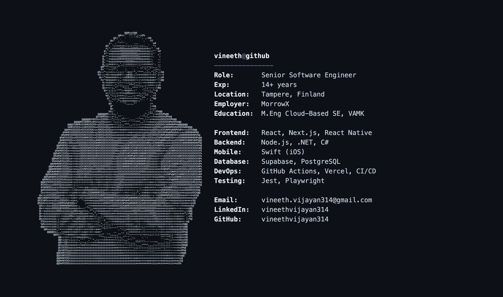

### Hi, I'm Vineeth 👋

Senior Software Engineer with 14+ years building web and mobile products end-to-end — from architecture through deployment. Based in Tampere, Finland.

- 🔭 Currently building full-stack apps with **Next.js**, **Supabase**, and **React Native**
- 🛠️ Stack: React · Next.js · TypeScript · React Native · Node.js · Swift · GraphQL · PostgreSQL
- 🎓 M.Eng in Cloud-Based Software Engineering, VAMK University of Applied Sciences
- 📫 Reach me: vineeth.vijayan314@gmail.com · [LinkedIn](https://linkedin.com/in/vineethvijayan314/)

#### Recent work
- **[opencode-analytics-viewer](https://github.com/vineethvijayan314/opencode-analytics-viewer)** — local-only dashboard + TUI plugin for OpenCode usage/cost analytics
- **[fullstack-log-app](https://github.com/vineethvijayan314/fullstack-log-app)** — full-stack logging app, Node/Postgres backend, Dockerized, CI-tested
